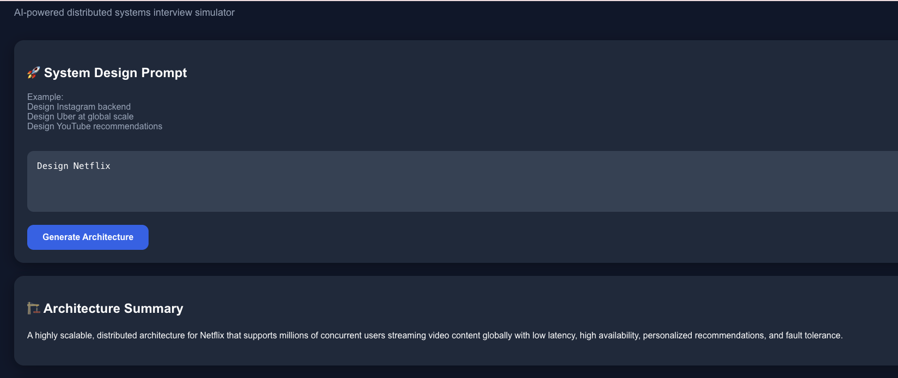
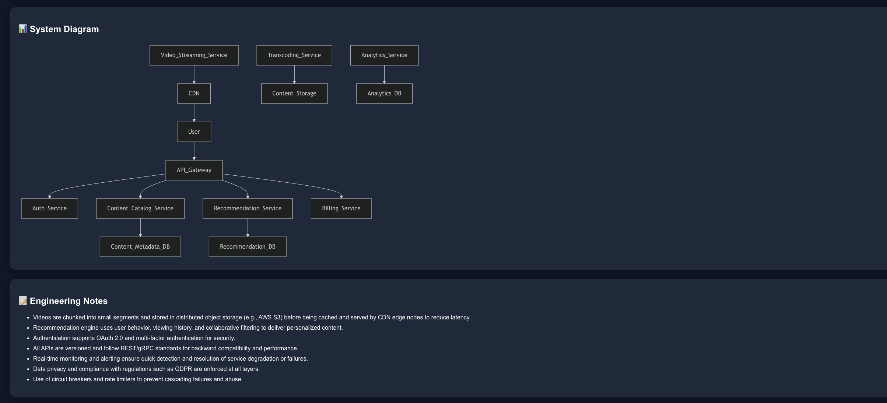
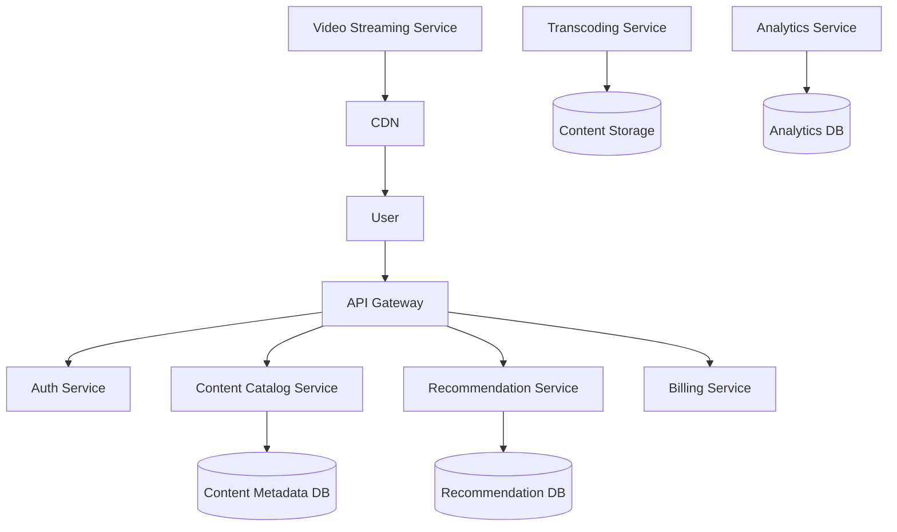

# System Design Interview Simulator

An AI-powered interview practice tool that generates distributed system architectures, visualizes them, reviews design trade-offs, and asks technical follow-up questions.



> **Screenshots:** Captured from a **“Design Netflix”** session. A genuine walkthrough GIF will be added when a full session can be recorded.

## Features

- **Architecture generation:** Explore service boundaries, APIs, databases, caching, load balancing, and scaling strategies for prompts such as Instagram, Uber, Netflix, or a URL shortener.
- **Visual diagrams:** Render AI-generated architecture diagrams with Mermaid.js.
- **Interview-style review:** Receive an overall score, ratings for scalability, clarity, and completeness, and feedback on strengths, weaknesses, and bottlenecks.
- **Bottleneck checks:** Flag potentially missing caches, load balancers, replicas, CDNs, or asynchronous queues using lightweight text-based checks.
- **Interviewer mode:** Generate follow-up, scaling, trade-off, and debugging questions about a proposed design.

## Example output: Design Netflix

The following screenshots capture a real session in the app. Scores and review excerpts are transcribed from those screenshots; generated results vary by prompt.

### Generated architecture



The Mermaid diagram below recreates the main connections visible in the captured architecture screenshot (it is a transcription, not the original raw model response):



### Architecture review


| Evaluation | Captured score |
| --- | ---: |
| Overall | **8/10** |
| Scalability | 8/10 |
| Clarity | 7/10 |
| Completeness | 9/10 |

**Highlighted bottleneck:** A single API gateway entry point could become a failure risk; the review recommends multi-region failover planning.

**Automatic check:** `No async queue detected → traffic spike risk`

**Illustrative follow-up question:** *How would you design failover if the primary API gateway region became unavailable?* (This question is an example of the interview format, not a saved output from the captured session.)

> **Note:** Feedback is AI-generated practice guidance, not a validated hiring assessment. Automatic checks are simple keyword heuristics and may miss or misidentify issues.

## Quick start

**Suggested development environment:** Python 3.11+, Node.js 20+, npm, Git, and an OpenAI API key. These are recommended local versions; the repository does not currently pin Python or Node versions.

**1. Clone the repository**

```bash
git clone https://github.com/vihaank1/System-Design-Simulator.git
cd System-Design-Simulator
```

**2. Start the backend** (macOS / Linux)

```bash
cd backend
python3 -m venv .venv
source .venv/bin/activate
python -m pip install -r ../requirements.txt
cp .env.example .env
# Add your OpenAI API key to .env
uvicorn main:app --reload
```

Backend: `http://127.0.0.1:8000` · API docs: `http://127.0.0.1:8000/docs`

**3. Start the frontend** (in another terminal, from the repository root)

```bash
cd frontend
npm install
npm start
```

Frontend: `http://localhost:3000`

The frontend is a regular React/Vite project in `frontend/`. If your API is hosted elsewhere, copy `frontend/.env.example` to `frontend/.env` and set `VITE_API_BASE_URL` before starting the dev server. The OpenAI key belongs only in `backend/.env`—never in frontend environment variables.

## How it works

```text
Design prompt entered in React
       ↓
FastAPI POST /generate → GPT-4.1-mini returns architecture JSON
       ↓
Mermaid.js renders the returned diagram
       ↓
FastAPI POST /review → AI-generated scores and feedback
                         + keyword-based bottleneck checks
       ↓
FastAPI POST /interview → follow-up and pressure-test questions
```

**Implementation details**

- **Generation:** `/generate` asks the OpenAI API for JSON fields including services, databases, caching, APIs, a scaling strategy, engineering notes, and Mermaid diagram source.
- **JSON parsing:** The backend strips Markdown code fences and calls `json.loads()`. It returns a parsing error payload when a response is invalid. The model is *prompted* to produce JSON; strict response-schema validation is not yet implemented.
- **Evaluation:** `/review` uses a language-model prompt to produce qualitative feedback and scores for scalability, clarity, and completeness. Scores are subjective coaching signals, not objective benchmarks.
- **Bottleneck detection:** A separate rule-based function looks for terms relating to caching, load balancing, replication, CDNs, and queues. It appends missing-component warnings to the review.
- **Follow-ups:** `/interview` requests three design follow-ups, two scaling questions, two trade-off questions, and one debugging question.

## Tech stack

| Layer | Technologies |
| --- | --- |
| Frontend | React, Axios, Mermaid.js |
| Backend | Python, FastAPI, Pydantic |
| AI | OpenAI API (GPT-4.1-mini) |

## Roadmap

- [x] AI-generated system architectures
- [x] Mermaid architecture visualization
- [x] Interview-style scoring and feedback
- [x] Rule-based bottleneck checks
- [x] Follow-up interviewer mode
- [ ] User authentication and saved interview history
- [ ] Timed and voice-enabled interviews
- [ ] Company-specific interviewer modes
- [ ] Collaborative mock interviews and editable architecture canvas
- [ ] Kubernetes deployment scenarios
- [ ] Persistent scoring and progress tracking
- [ ] Stronger JSON schema validation and more robust bottleneck checks
- [ ] Record a real 10-second prompt → diagram → review walkthrough GIF

## Contributing

Suggestions, bug reports, and pull requests are welcome. Open an issue to describe the change, or fork the repository and submit a focused pull request.

## License

Licensed under the [MIT License](LICENSE).